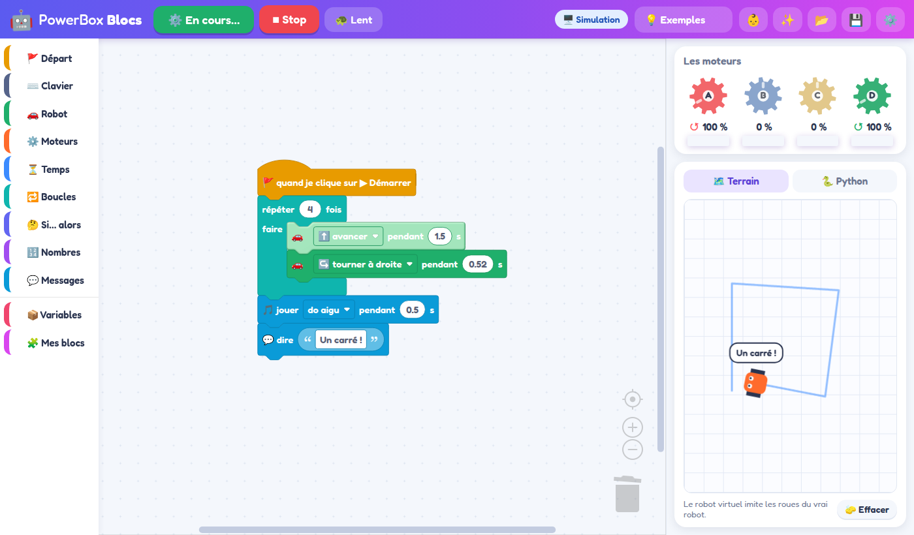
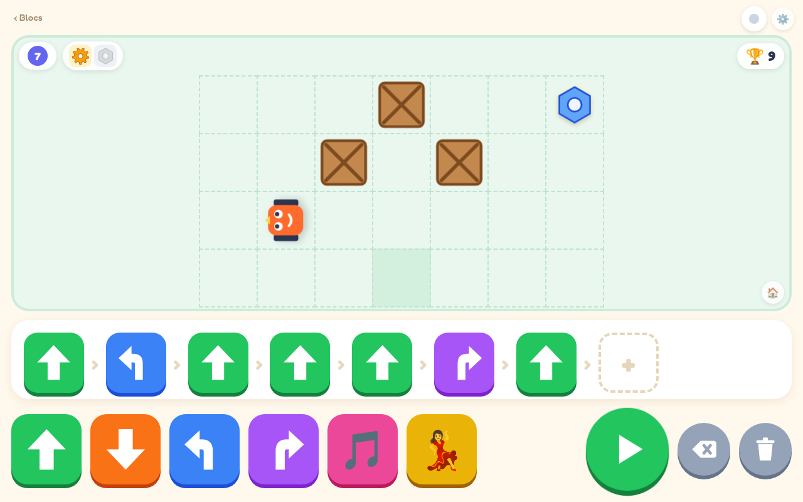

# PowerBox

Programmer depuis un PC Linux le boîtier Bluetooth « powerbox », vendu avec des moteurs compatibles
LEGO (4 sorties A/B/C/D, appli Android `com.yundongjia.app.blocks_powerbox`). On peut le faire
avec des blocs, avec de grosses tuiles pour les tout-petits, ou en Python.

| Mode | Pour qui | Comment |
|---|---|---|
| **PowerBox Petits** | dès 3 ans, sans savoir lire | de grosses tuiles posées sur une ligne ; le robot avance case par case pour ramasser ses pièces, niveau après niveau |
| **PowerBox Blocs** | dès qu'on lit un peu | des blocs façon Scratch, en français, avec un robot virtuel |
| **Python « facile »** | pour passer au vrai code | `avancer(2)`, `moteur("A", 80)`… Les blocs se traduisent en Python |

<p align="center">
  
  
</p>

**État** : les moteurs du boîtier tournent pour de vrai (testé le 07/11/2026 sur un ThinkPad X390
sous Linux Mint, sans arrêter le service Bluetooth du système). Les deux interfaces et la
bibliothèque ont été testées en simulation. Voir [ce qui reste à vérifier](#ce-qui-reste-à-vérifier).

---

## Installation

### Avec l'AppImage (le plus simple)

Un seul fichier, qui embarque Python : rien à installer. Linux x86_64 uniquement.

**[⬇️ Télécharger PowerBox-x86_64.AppImage](https://github.com/julienrat/Powerbox_Block/releases/latest/download/PowerBox-x86_64.AppImage)**
(page des [versions](https://github.com/julienrat/Powerbox_Block/releases))

```bash
chmod +x PowerBox-x86_64.AppImage
./PowerBox-x86_64.AppImage              # ou double-clic dans le gestionnaire de fichiers
./PowerBox-x86_64.AppImage installer    # ajoute PowerBox au menu des applications (facultatif)
```

L'AppImage ouvre l'interface dans le navigateur. Elle s'arrête toute seule environ deux minutes après
la fermeture de la page. Si on la relance alors qu'elle tourne déjà, elle rouvre simplement la page.

Autres commandes :

| Commande | Effet |
|---|---|
| `PowerBox-x86_64.AppImage --simulation` | sans boîtier (seul le robot de l'écran bouge) |
| `PowerBox-x86_64.AppImage mon_programme.py` | lance un programme Python exporté depuis les blocs |
| `PowerBox-x86_64.AppImage scan` | liste les boîtiers à portée |
| `PowerBox-x86_64.AppImage cli --set a=100 --duration 2` | ligne de commande bas niveau (voir plus bas) |
| `PowerBox-x86_64.AppImage python` | l'interpréteur Python embarqué |
| `PowerBox-x86_64.AppImage desinstaller` | retire PowerBox du menu |
| `PowerBox-x86_64.AppImage --help` | toutes les options du serveur |

**Construire l'AppImage** (il faut internet la première fois) :

```bash
tools/build-appimage.sh          # → dist/PowerBox-x86_64.AppImage (environ 12 Mo)
```

Le script télécharge un [Python 3.12 prêt à l'emploi](https://github.com/niess/python-appimage) et
[appimagetool](https://github.com/AppImage/appimagetool) dans `build/appimage-cache/`. Il y ajoute le
paquet `powerbox`, retire ce qui ne sert pas (Tk, pip…), puis empaquette le tout.

### Depuis les sources

Il faut Python ≥ 3.9, et aucune dépendance.

```bash
git clone https://github.com/julienrat/Powerbox_Block.git
cd Powerbox_Block
python3 -m powerbox.serveur                 # ouvre http://localhost:8080
python3 -m powerbox.serveur --simulation    # sans boîtier
```

| Option | Effet |
|---|---|
| `--simulation` | pas de boîtier |
| `--auto` | se connecte au boîtier dès le démarrage, sans attendre le bouton Connecter |
| `--address AA:BB:…` | boîtier par défaut (sinon `22:01:01:27:0F:7D`) |
| `--port 8080` | port du serveur (le suivant est pris s'il est occupé) |
| `--host 0.0.0.0` | ouvre l'interface aux autres appareils du réseau (tablettes). Attention : n'importe qui sur le réseau peut alors piloter les moteurs |
| `--pas-de-navigateur` | n'ouvre pas le navigateur |
| `--app` | s'arrête quand plus aucune page n'est ouverte (c'est ce qu'utilise l'AppImage) |

`pip install -e .` ajoute les commandes `powerbox-blocs` et `powerbox`.

## Se connecter au boîtier

1. Allumer le boîtier. **Aucun téléphone ne doit y être connecté**, car le boîtier n'accepte qu'une
   connexion à la fois.
2. Dans PowerBox Blocs, cliquer sur **🔵 Connecter**. La fenêtre « Choisir ta PowerBox » cherche
   les boîtiers pendant 5 s et les classe du plus proche au plus lointain (barres de signal).
   - ✏️ donne un nom à un boîtier (« Robot de Léa »), pratique quand il y en a plusieurs ;
   - ⭐ marque le dernier boîtier utilisé ;
   - un boîtier **grisé, « pas vu »**, est éteint ou déjà connecté ailleurs : un boîtier connecté
     n'émet plus de signal pour être trouvé ;
   - on peut aussi taper l'adresse à la main.
3. Le voyant passe au vert. **⏏ Déconnecter** arrête les moteurs et libère le boîtier. Un clic sur
   le voyant vert permet de changer de boîtier.

**Coupures et reconnexions** :
- Si le lien tombe, le serveur se reconnecte aussitôt, sans rien afficher. Pendant une coupure
  courte (moins de 12 s), le voyant reste vert.
- Le message « boîtier introuvable » ne s'affiche qu'après un clic sur Connecter, jamais pendant
  les reconnexions automatiques.
- Si les essais échouent, ils s'espacent (2, 4, 8 puis 15 s) au lieu de s'enchaîner.
- **Sécurité** :
  - après une reconnexion, les moteurs ne reprennent que si une page pilote encore ; sinon ils
    restent à l'arrêt ;
  - si plus aucune page n'est ouverte depuis 60 s, le serveur libère le boîtier et arrête les
    essais ; il se reconnecte dès qu'une page revient.
- Le terminal du serveur note chaque coupure avec sa durée (« liaison coupée après 30 s »).

Le mode Petits a un simple rond en haut à droite, qui se connecte au dernier boîtier choisi.

## PowerBox Petits (dès 3 ans)

Bouton 👶 du mode Blocs, ou `http://localhost:8080/petits.html`. Le principe est celui des
robots-abeilles de maternelle, sans rien à lire.

- **6 grosses tuiles** : ⬆️ avancer d'un pas, ⬇️ reculer, ↰ ↱ quart de tour, 🎵 musique, 💃 danse.
  Toucher une tuile l'ajoute **au bout de la ligne**, qui se lit de gauche à droite (12 tuiles au plus).
  Une case « + » montre où ira la suivante.
- **▶** lance le programme. Chaque tuile s'allume à son tour et une voix la dit (« Avance ! »).
  Le vrai robot bouge, et le robot de l'écran avance **case par case**.
- **Le jeu : réparer le robot.** Des **pièces de robot** sont posées sur le terrain : engrenage,
  écrou, pile, roue. Le robot les ramasse en passant dessus, et chacune rapporte un point
  (🏆 en haut à droite). En haut à gauche, on voit le numéro du niveau et les pièces encore à trouver.
- **Des caisses** bloquent certaines cases : le robot de l'écran bute dessus et reste sur place.
- **Les niveaux** : quand toutes les pièces sont ramassées, le robot est réparé. C'est la fête, puis on
  passe au niveau suivant avec une ligne vide. Les 8 premiers niveaux sont dessinés (tout droit, un
  virage, une caisse à contourner…). Après, ils sont tirés au hasard, en vérifiant qu'on peut atteindre
  toutes les pièces. Le niveau et le score sont gardés d'une fois sur l'autre.
- Toucher une tuile de la ligne la fait seulement entendre, elle n'est pas effacée. **⌫** enlève
  la dernière tuile. **🗑️** efface tout, puis devient **↩️ annuler** pendant 5 s. **🏠**
  recommence le niveau : le robot revient au départ et les pièces reviennent, le score est gardé.
- **⚙️ (pour les grands)** : durée d'un pas, durée d'un quart de tour, vitesse, voix, choix du niveau,
  remise à zéro du score. Toucher le numéro du niveau ouvre aussi ces réglages. Il faut **régler
  le quart de tour sur le vrai robot** pour qu'il tourne d'un angle droit. La valeur de départ,
  0,55 s, n'a pas été mesurée.

Le vrai robot exécute toujours les tuiles, même quand celui de l'écran bute contre une caisse ou
un bord.

La voix est celle du navigateur. Sous Linux, Chrome n'a pas toujours de voix française : les tuiles
jouent alors seulement leur note.

## PowerBox Blocs

- **Blocs** :
  - 🚩 Départ : « quand je clique sur Démarrer » ;
  - ⌨️ Clavier : « quand j'appuie sur / je relâche une touche », « touche appuyée ? »,
    « attendre que j'appuie sur » ;
  - 🚗 Robot : avancer, reculer, tourner, virage, pendant N secondes ou sans s'arrêter ; vitesse ;
  - ⚙️ Moteurs : moteur A–D ↻/↺ à N %, pendant N s, arrêter, vitesse d'un moteur ;
  - ⏳ attendre, 🔁 boucles (dont « pour toujours »), 🤔 conditions, 🔢 nombres et hasard ;
  - 💬 dire, 🎵 jouer une note, 📦 variables, 🧩 Mes blocs (fonctions).
- **À droite** :
  - les 4 engrenages A–D tournent à la vitesse des moteurs ;
  - un **robot virtuel** roule sur un quadrillage en laissant une trace. On peut donc essayer un
    programme (un carré…) sans boîtier.
- **🐢 Lent** : chaque bloc s'allume pendant qu'il s'exécute.
- **🐍 Python** : le programme traduit en Python (`powerbox.facile`), à copier ou télécharger.
  Le fichier se lance tel quel.
- **💡 Exemples** : premier pas, carré, danse, télécommande au clavier, pilotage (garder la touche),
  accélération, essuie-glace.
- **⚙️ Réglages** : sorties des roues gauche et droite (A et D par défaut, comme l'appli), et
  inversion du sens de chaque roue.
- **Enregistrement** : le programme est gardé automatiquement dans le navigateur. 💾 et 📂
  l'enregistrent dans un fichier ou le rouvrent. ✨ démarre un nouveau programme.
- **Clavier** : Échap arrête le programme. Pour jeter un bloc, on le fait glisser dans la poubelle.

Seuls les blocs accrochés sous un bloc « quand… » s'exécutent. Les blocs isolés apparaissent grisés.

## Bibliothèque Python « facile »

```python
from powerbox.facile import *

avancer(2)                  # le robot avance 2 s (roues : A = gauche, D = droite)
tourner_droite(0.5)
vitesse_robot(60)           # en %
moteur("B", 80)             # -100..100, le signe donne le sens ; continue jusqu'au prochain ordre
attendre(1)
moteur_pendant("C", -50, 2)
arreter()                   # tout ; arreter("B") pour un seul moteur
dire("Fini !")

@quand_touche("haut")       # flèches, "espace", "entree", lettres, chiffres
def en_avant():
    avancer(0.3)

ecouter_touches()           # jusqu'à Échap
```

- **Robot** : `reculer`, `tourner_gauche`, `virage_gauche` et `virage_droite` (en arc),
  `arreter_robot`, `robot("avancer", 2)`. Les roues se changent avec
  `roues(gauche="B", droite="C", inverser_droite=True)`.
- **Moteurs** : `vitesse_moteur("A")` donne la vitesse actuelle.
- **Son** : `note("do", 0.5)`.
- **Clavier** : `touche_appuyee("haut")`, `attendre_touche("espace")` (ou `attendre_touche()` pour
  n'importe quelle touche), `@quand_touche_relachee("haut")`. Un terminal ne signale pas quand on
  relâche une touche : elle est considérée relâchée environ 0,6 s après la dernière répétition du
  clavier. Dans l'interface web, c'est immédiat.
- **Connexion** : elle se fait toute seule à la première commande, et les moteurs s'arrêtent à la
  fin du programme, même après Ctrl+C ou Échap.
- **Choisir le boîtier** : `POWERBOX_ADRESSE=AA:BB:… python3 prog.py`.
- **Sans boîtier** : `POWERBOX_SIMULATION=1 python3 prog.py` affiche les vitesses au lieu de les
  envoyer.

## Pour les développeurs

### Classe `PowerBox`

```python
import time
from powerbox import PowerBox

with PowerBox() as box:          # connexion ; arrêt des moteurs et déconnexion à la sortie
    box.set(a=100, d=-100)       # vitesses brutes -127..127, plusieurs sorties à la fois
    time.sleep(2)
    box.motor("b", -50)
    time.sleep(1)
    box.stop()
```

La trame est renvoyée toutes les 0,2 s pour maintenir la commande. Voir aussi
[examples/demo.py](examples/demo.py).

### Ligne de commande bas niveau

```bash
python3 -m powerbox                              # mode interactif : a 100, d -60, all 0, stop, raw …, q
python3 -m powerbox --set a=100 d=-100 --duration 3
python3 -m powerbox --status                     # affiche aussi les trames d'état du boîtier
python3 -m powerbox.scan                         # boîtiers à portée
```

Options : `--address`, `--repeat 0.2` (0 = n'envoyer qu'aux changements), `--req` (écritures avec
réponse ; inutile, le boîtier n'y répond pas quand bluetoothd est actif), `--discover` (liste GATT,
seulement si bluetoothd est arrêté), `-v` (tous les paquets ATT).

### Comment marche l'interface web

Le programme de blocs est **exécuté dans la page**. Le serveur ne reçoit que des vitesses et
n'exécute aucun code envoyé par la page.

| Requête | Effet |
|---|---|
| `GET /api/etat` | connexion, adresse, vitesses |
| `POST /api/moteurs {"a": 80, "d": -80}` | vitesses en % (-100..100) |
| `POST /api/stop` | tout arrêter |
| `GET /api/scanner[?tous=1]` | boîtiers à portée (5 s, via `bluetoothctl`) |
| `POST /api/connecter {"adresse": "…"}` | se connecter, avec reconnexion automatique |
| `POST /api/deconnecter` | arrêter les moteurs et libérer le boîtier |

- **Sécurité** :
  - les POST doivent être en `application/json`, ce qui empêche une autre page web de piloter les
    moteurs ;
  - si plus aucune requête n'arrive pendant 3 s alors que des moteurs tournent, tout s'arrête.
- **Blockly** : la version 11.2.1 est fournie dans `powerbox/web/vendor/`, donc tout marche sans
  internet. Seule la police Fredoka vient de Google Fonts ; sans internet, une police du système la
  remplace.
- **Bluetooth direct (expérimental, non testé)** : si la page est ouverte sans le serveur (Chrome
  Android, Chromebook), le bouton Connecter essaie de se connecter directement en Web Bluetooth. Ça ne
  marche pas avec Chrome sous Linux, pour la raison expliquée plus bas.

### Le protocole en bref

On écrit dans la caractéristique `0000ffa1-0002-1000-8000-00805f9b34fb` (poignée ATT `0x0011`) une
trame de 16 octets :

```
FC 0F 01  A  B  C  D  00  00 00 00 00 00 00 00  CS
          └──┴──┴──┴─ un octet par sortie : bit 7 = sens, bits 0-6 = vitesse (0..127)
                                                 CS = (somme des 15 premiers octets) & 0xFF
```

| Trame | Effet |
|---|---|
| `FC0F010000000000000000000000000C` | tout arrêter |
| `FC0F017F00000000000000000000008B` | A à fond, sens 1 |
| `FC0F01FF00000000000000000000000B` | A à fond, sens 2 |

Dans l'appli, « avancer » envoie `FF` sur A et D. Le détail est dans
[docs/protocole.md](docs/protocole.md), et la façon dont le protocole a été retrouvé (décompilation de
l'appli) dans [docs/reverse-engineering.md](docs/reverse-engineering.md).

### Tests

```bash
python3 -m unittest discover -s tests     # protocole et bibliothèque « facile »
```

## Dépannage

**« Boîtier introuvable » / la connexion n'aboutit pas**
- Le boîtier est-il allumé et à portée ?
- Un téléphone (l'appli, nRF Connect) y est-il encore connecté ?
- Le premier essai échoue parfois : le serveur réessaie toutes les 3 s.
- En dernier recours, essayer avec `sudo`.

**Le robot recule au lieu d'avancer, ou tourne sur lui-même** : dans ⚙️ Réglages du mode Blocs,
cocher « inverser » pour la roue qui tourne à l'envers, ou changer les sorties des roues.

**Le vrai robot ne tourne pas d'un angle droit (mode Petits)** : régler « durée d'un quart de tour »
dans ⚙️.

**Des notifications « connecté / déconnecté » s'affichent sans arrêt** : celles du bureau viennent de
blueman. Pour les couper :
`gsettings set org.blueman.general plugin-list "['!ConnectionNotifier']"`
(et `"[]"` pour les remettre).

**La liaison tombe régulièrement (environ toutes les 30 s ?)** : c'est une piste, pas encore vérifiée.
`bluetoothd` envoie au boîtier une négociation de taille des paquets (« Exchange MTU »), à laquelle
le boîtier ne répond jamais, et il pourrait couper la liaison au bout de 30 s. Le serveur se
reconnecte tout seul, sans rien afficher. Le terminal du serveur indique la durée de chaque
liaison : si elle tourne autour de 30 s, c'est cette cause.

**L'AppImage ne se lance pas (« FUSE »)** : `./PowerBox-x86_64.AppImage --appimage-extract-and-run`,
ou installer `libfuse2`.

**Pourquoi pas bleak, gatttool ou Web Bluetooth sous Linux ?**
- À chaque connexion, le service Bluetooth de Linux (`bluetoothd`) demande au boîtier de négocier
  la taille des paquets (« Exchange MTU »). Le boîtier ne répond jamais.
- Le protocole n'autorise qu'une requête en attente à la fois : tout ce qui attend une réponse reste
  donc bloqué (découverte des services, lecture, écriture avec accusé).
- Ce projet contourne le problème : il ouvre directement le canal ATT auprès du noyau (socket
  L2CAP), et il envoie des **Write Command** (écritures sans réponse) sur la poignée `0x0011`,
  connue d'avance.

**Lister les caractéristiques (`--discover`)** : il faut arrêter bluetoothd, ce qui coupe aussi la
souris et le casque Bluetooth pendant ce temps.

```bash
sudo systemctl stop bluetooth && sudo btmgmt power on
python3 -m powerbox --discover
sudo systemctl start bluetooth
```

## Organisation du dossier

```
Powerbox_Block/
├── powerbox/                 le paquet Python (aucune dépendance)
│   ├── protocol.py           trames, encodage des vitesses, somme de contrôle, trames d'état
│   ├── att.py                transport ATT brut (socket L2CAP, CID 4) sans BlueZ
│   ├── device.py             classe PowerBox (connexion, set/motor/stop, renvoi périodique)
│   ├── simulation.py         faux boîtier (même interface, affiche les vitesses)
│   ├── facile.py             bibliothèque pour les enfants (avancer, moteur, attendre, clavier…)
│   ├── scan.py               recherche des boîtiers à portée (via bluetoothctl)
│   ├── serveur.py            serveur des interfaces web (python3 -m powerbox.serveur)
│   ├── cli.py                ligne de commande bas niveau (python3 -m powerbox)
│   └── web/
│       ├── commun.js         partagé : liaison au boîtier, sons, réglages des roues
│       ├── index.html, app.js, blocs.js, exemples.js, style.css    PowerBox Blocs
│       ├── petits.html, petits.js, petits.css                       PowerBox Petits
│       └── vendor/blockly/   Blockly 11.2.1 (Apache-2.0)
├── tests/                    python3 -m unittest discover -s tests
├── examples/demo.py
├── docs/                     protocole, rétro-ingénierie, captures d'écran
└── tools/
    ├── build-appimage.sh     construit dist/PowerBox-x86_64.AppImage
    ├── appimage/             AppRun, raccourci .desktop, icône
    └── blutter-dispatch-dump.patch, re/dart_re.py    outils de rétro-ingénierie
```

L'APK et sa décompilation ne sont pas dans le dépôt.

## Ce qui reste à vérifier

- **Sur le vrai boîtier** :
  - les interfaces web, avec plusieurs boîtiers ;
  - la durée d'un quart de tour dans le mode Petits ;
  - le lancement depuis l'AppImage.
- **Connexion Bluetooth directe** (Web Bluetooth) sur Android ou un Chromebook.
- **Trame d'état** : l'octet `04` est-il le niveau de batterie ?
- **Mode « diffusion » de l'appli** : sans connexion, comme les boîtiers Mould King, via
  `libble.so`. C'est peut-être le langage de la télécommande. Non décodé.

## Licence

Blockly est sous licence Apache-2.0 (voir `powerbox/web/vendor/blockly/`).
